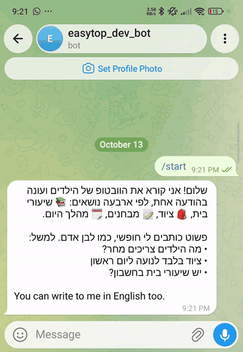
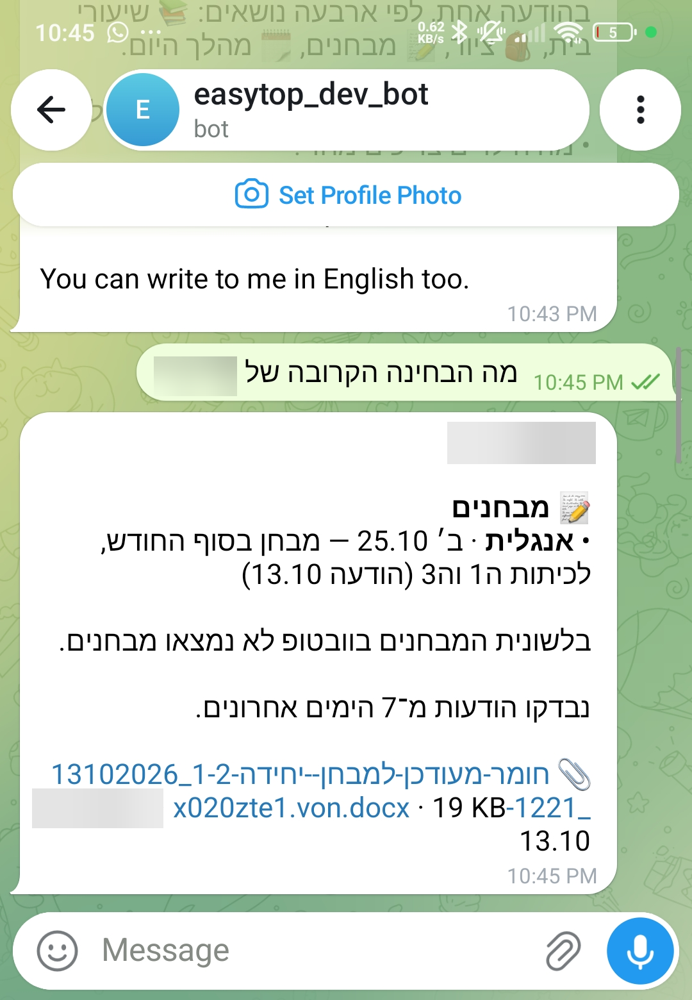
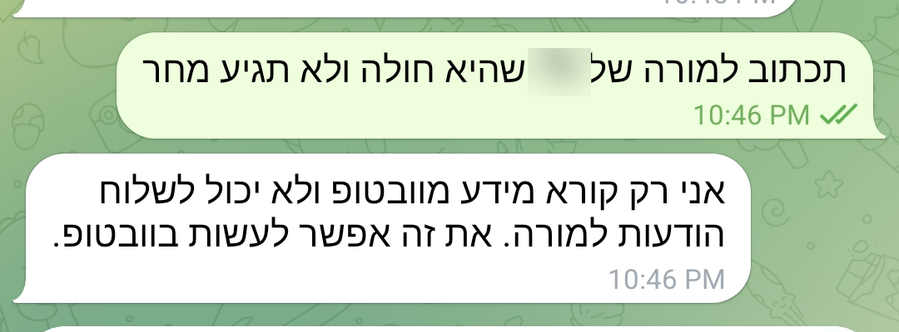
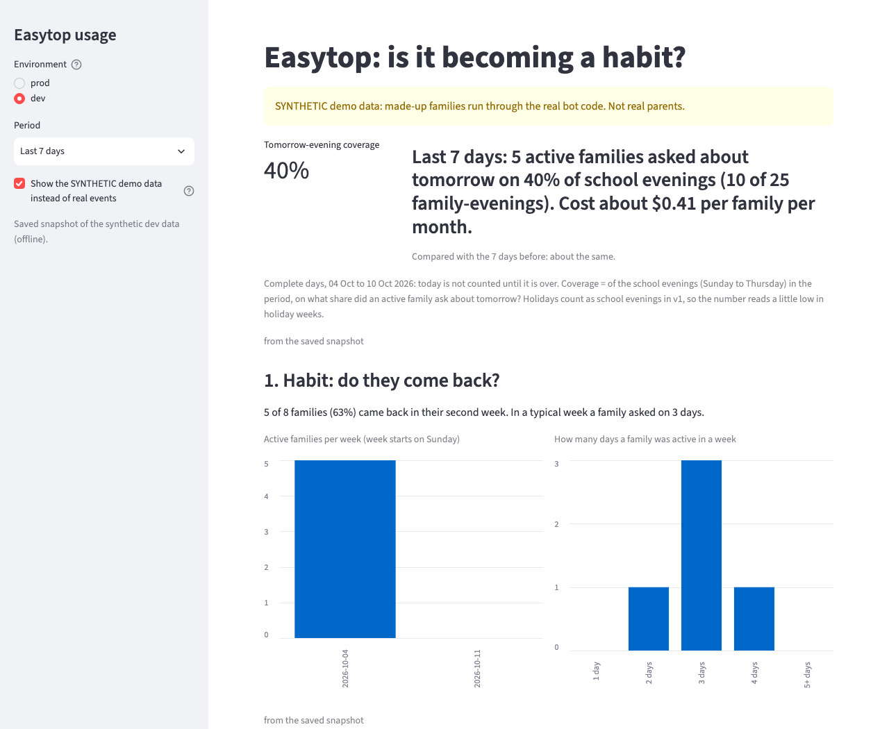
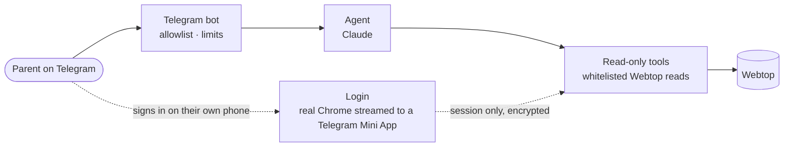

# Easytop

**Your own chat agent for your family's Webtop.** Ask about your kids' school in your own words, in Telegram.
Easytop reads Webtop and answers. It never changes anything in Webtop.

## In short

Parents already check Webtop every evening: for each child, what is due, what to bring, what is coming up. All of it is
there, spread over timetables, homework, equipment notes, exams and teachers' messages. Easytop adds another way in: one
plain question covers every child and every place Webtop keeps it, and the answer comes back in the parent's own language.

- **Read-only.** It answers only from what Webtop returns, through a small set of [read-only tools](docs/guardrails.md). It cannot send,
  reply, approve or change anything.
- **A reminder that costs almost nothing.** A parent asks once for an evening reminder. From then on a timer sends what
  is due tomorrow, written by code straight from Webtop, with no model call. The model is only for the questions a
  reminder cannot answer.
- **The parent signs in themselves.** On their own phone, inside Telegram, on Webtop's real sign-in page ([how it works](docs/phone-login.md)). Any captcha is
  solved by the parent. Only the session is kept, encrypted, never a password.
- **No content in logs.** Usage is [measured with counts, durations and costs](docs/observability.md); no question,
  answer or child detail is stored or logged.

It works today on real family accounts, in a small closed test. Python, Claude Sonnet 5.5 with tool use, Supabase, Cloud Run.

## What it does

### Ask once, get every child

"What do the kids need tomorrow?" Easytop gathers homework, equipment, exams and the day's flow for each child from
every place Webtop holds them, and answers as briefly as it can: what is due or needed on the next school day, and one
closing line about what is coming later.

*A real family account in Hebrew; the children's names are blurred.*

### One child, one category, with the source

Ask about one child and one category: "when is the next exam?" When an item comes from a teacher's message, the answer names that message, and the files
attached to it are listed under the answer. A tap sends the file into the chat, fetched read-only from the parent's own
inbox.

*The exam comes from a teacher's message, and the file attached to it is listed under the answer.*

### A reminder every evening

Ask once, in any wording: "remind me every evening at 8". From then on the reminder arrives on its own, with what is due
tomorrow for each child. No model is involved, so it costs almost nothing to run.

### It says what it cannot do

Asked to write to a teacher, Easytop says it can only read and points the parent to Webtop. Anything that must never
happen is enforced in code, not only in the prompt.

*Asked to tell a teacher that a child is sick: it declines and points to Webtop.*

### Usage without the kids' data

Every question becomes one content-free event: labels, tokens, cost and time, with parents only as a pseudonym. A
dashboard reads them.

*The usage dashboard, on synthetic data.*

## Architecture

Each layer talks only to the one below. The agent never sees raw Webtop responses, only trimmed, normalized fields. The
parent and the session are bound by the caller, never chosen by the model, so one family cannot see another. The core is
channel-agnostic: Telegram is the first adapter.

## Notice

Easytop is an independent project, not affiliated with or endorsed by SmartSchool. It only reads what a parent can
already see in Webtop, through the parent's own session. The parent signs in and solves any captcha themselves, and
nothing is ever written to Webtop.

All rights reserved.
