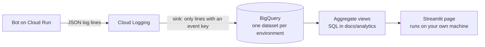

# Observability without seeing the kids' data

What Easytop records about its own use, how it keeps children's data out of that record, and how the record is read.
Back to the [README](../README.md).

Every question becomes one content-free event (labels derived by code from the tool calls, tokens, cost, time; parents
only as an HMAC pseudonym) that a log sink copies to BigQuery for a Streamlit page. A test pushes a child's name, a
question, an answer, a cookie and a phone number through the bot and proves that none of them reaches any log line or
event.

The aim is to be able to say how the product is used, what it costs and where it breaks, without ever being able to
read what a parent asked or what a child's school said.

## What an event holds

The code is `src/easytop/analytics.py`. Every event is one flat JSON object, written as a log line with an `event` key.
A log sink copies only the lines that have that key to BigQuery. The ordinary operations log (human-readable lines for
debugging) stays in Cloud Logging and never reaches BigQuery.

Every event carries `event`, `schema` (a version number), `env` (dev, prod, local or test), `ts` (UTC), `synthetic`
(true for made-up demo data) and, when a parent is involved, `parent_ref`.

`parent_ref` is `"p_"` plus the first 16 hex characters of an HMAC-SHA256 of the parent's channel identity. The key of
that HMAC is derived from the environment's session encryption key, so no new secret exists, the references of dev and
prod never match, and re-identifying a reference needs the same key that already decrypts the stored sessions. Without
that key (a run on a laptop) the salt is random per process.

Every field and every event is declared in a schema. Strings are only values from a fixed list or the class name of an
exception, never free text. An unknown event, an unknown field, a value outside its list or a type that differs from
the same field in another event is refused: it raises in tests, and in production it is dropped with a warning so the
bot never breaks over it.

| Event | Fields |
|---|---|
| `question` | `outcome`, `category`, `focus`, `kids_scope`, `language`, `follow_up`, `model`, `answer_ms`, `tool_count`, `tools`, `input_tokens`, `output_tokens`, `cache_read_tokens`, `cache_write_tokens`, `cost_usd`, `error_type` |
| `access_denied` | `reason` (not allowed, bad invite) |
| `invite_created` | `ttl_hours` |
| `invite_redeemed` | none |
| `connect_offered` | `reason` (first, expired, no kids, wrong account) |
| `connect_opened` | none |
| `connect_abandoned` | `reason` (left, timeout, failed, link expired), `login_seconds` |
| `login_captured` | `route` (ministry, code, password, unknown), `login_seconds`, `cookie_hours`, `taps`, `frames_dropped` |
| `kids_confirmed` | `kid_count`, `school_count`, `reconnect` |
| `kids_rejected` | `kid_count` |
| `nudge_setting` | `state` (on, off, declined), `hour`, `content` (none, due, all) |
| `nudge` | `result` (sent, no school, expired, failed), `content` (none, due, all) |
| `session_check` | `status` (ok, dead, unknown), `age_h` |
| `session_expired` | none |
| `error` | `where` (agent, onboarding, login, nudge, health, telegram, bot), `error_type` |

The labels on a `question` are worked out by code from the tool calls the agent actually made (names and arguments,
read in memory and never written anywhere), with no extra model call:

- `category`: the one data tool used (tomorrow, schedule, homework, messages, exams, events), `reminder` for the
  reminder setting, `mixed` for several,
  `kids` for only the list of children, `none` for no tool at all.
- `focus` (tomorrow only): homework, equipment, exams, flow or all. `kids_scope`: one, several or all children.
- `language`: from the letters of the question (Hebrew, English, Russian, Arabic or other). `follow_up`: the same
  parent asked within the last 10 minutes.
- `outcome`, checked in this order: session expired, error, truncated, tool limit, answered, answered with no data, and
  rate limited (no model call was made).

What is never recorded: the text of a question or an answer, a child's, teacher's or school's name, a Telegram id, a
cookie, a phone number, an ID number, or any other free text.

The limits are stated rather than hidden. Code cannot tell a question that was out of scope, a request to change
something, and a message that tried to inject instructions from one another: all three are `answered with no data`,
and that they are handled correctly is shown by the [guardrail evals](guardrails.md), not by the dashboard.

## Proof

`tests/test_privacy_end_to_end.py` runs the real gateway, onboarding flow, session registry, invites, reminder settings,
hourly session check and Telegram error path, with fakes in place of the model and of Webtop (a scripted client and a
synthetic family). It plants recognisable secrets: a child's name in Hebrew and in Latin letters, the question, the
answer, a homework text, a teacher's name, a school's name, a cookie value, a phone number and an ID number. It then
captures every log record of every logger at every level, formats each one as text and as JSON, and collects every
analytics event. None of the planted strings may appear in any of it, and no Telegram id may appear in an event. It
fails if the scenario produces fewer than ten events, so it cannot pass by doing nothing. It was proven to fail by
planting a leak when it was written. Schema tests add the other half: an unknown event, an unknown field, free text in
a field that only allows fixed values, and a type change across events each fail.

## Pipeline

In dev a second table holds made-up demo events from `tools/analytics/synthetic.py` (the synthetic family through the
real gateway), every row marked `synthetic: true`. The views, the setup scripts and a click guide for Looker Studio are
in [analytics/README.md](analytics/README.md).

## The dashboard

`tools/dashboard/` is a one-page Streamlit app that answers the product questions in plain sentences, with the
aggregation done in BigQuery views and a few small parameterised queries on top. It is organised by question, not by
data type:

- **Headline, tomorrow-evening coverage:** of the school evenings in the period, on what share did a family that uses
  the product ask about tomorrow? The promise is one message each school evening, so this is the number that says
  whether it works.
- **Habit:** do parents come back? Active families per week, days active, return in the second week.
- **Activation:** can a new parent get in? The funnel from invite to first answer, and the median time from the
  connect button to that answer.
- **Friction:** what gets in the way? Reconnects per family per week, and how long a sign-in lasts by route.
- **Worth it:** is it fast, reliable and cheap enough? Cost per family per month, the time within which 95% of answers
  arrive, the share of failures and of answers with no data, and how often a reminder is followed by a question.

The page never shows a pseudonym or a row for one family: with a few families, one row would identify them to anyone who
knows them. With fewer than 5 families it states counts instead of percentages, and it says "too little data to
compare yet" instead of a change it cannot support. Under each section a grey line shows what the query scanned or
that the result came from cache.

To look at it without any account, run it on the saved snapshot of the synthetic data:

    EASYTOP_DASHBOARD_SOURCE=snapshot uv run --extra dashboard streamlit run tools/dashboard/app.py

With a Google Cloud project that has the events (`uv run --extra dashboard streamlit run tools/dashboard/app.py`, after
`gcloud auth application-default login`) it reads the real views instead. Its tests run offline on the snapshot:
`uv run --extra dashboard pytest tests/dashboard`.
