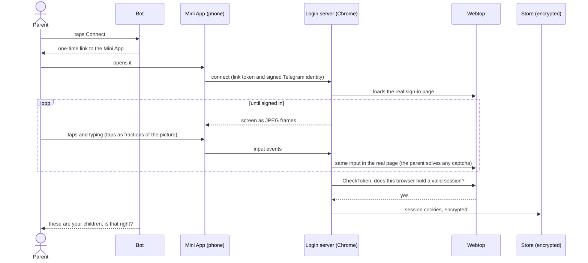

# Phone-only login

How a parent connects their own Webtop account from a phone, inside Telegram, without touching the captcha, and what
was learned making it work on real phones. Back to the [README](../README.md).

## The idea

Webtop's sign-in page is built for a person at a screen, and it may ask for a captcha. Easytop does not try to get
around that. The parent signs in themselves, on Webtop's real sign-in page, and solves any captcha themselves:

- A Chrome on the server loads the real sign-in page. Its picture is streamed, as JPEG frames, to a Telegram Mini App
  on the parent's phone. Taps and typing travel back and are forwarded to that page.
- We never click the captcha, never extract or replay a captcha token, and never hide that the browser is automated.
- When Webtop itself says the browser holds a valid session (its `dashboard/CheckToken` call), the session cookies go
  to the onboarding flow and are stored encrypted. Nothing else is kept: no password, no captcha data, nothing typed.
- A link to the page is made for one parent, works once, and opens only for that Telegram user (it checks the signed
  Mini App identity).

## Rules learned on real phones

Each of these was found on a real phone, usually after a reasoned fix failed. The page's tests run under an Android
Chrome engine and an iOS WebKit engine, but they are simulations: keyboard and typing changes are confirmed on real
devices.

- **One fixed remote size.** The remote screen is always 392 x 687 pixels, and the page hard-codes the same numbers (a
  test keeps them equal). The remote browser is never resized: real Chrome gives wrong-size frames after a resize. The
  phone scales the picture and slides it up when the keyboard opens.
- **Taps and scrolls are fractions of the picture.** The server never needs to know the phone's size.
- **Keyboard.** Taps come from a genuine `click`, and the touch events are never cancelled. A phone ignores `focus()` on
  a field that is already focused, so the page releases the field first (on Android it refocuses 60 ms later). The
  hidden input starts with an invisible marker so that Backspace reaches text that is already in the field. A field
  counts only if it is visible at that spot (not under the captcha's picture grid), and the whole visible field box is
  the target. A keyboard button is the sure way in, judged by the screen shrinking rather than by focus.
- **Speed.** A Webtop page is kept loaded and waiting before anyone connects. There is one shared browser, websocket
  compression is off, stale frames are dropped, and focus checks never block the next tap. Caching Webtop's static
  files was measured and was slower, so it is not done.
- **Measure before guessing.** For phone problems, numbers-only logging (counts and timings) found the cause where two
  reasoned fixes in a row had not.

The server logs numbers only. It never logs what was typed, a code, a cookie value or anything from the captcha.

## Sign-in routes and session length

The Mini App shows tabs above the picture for Webtop's three sign-in routes:

| Route | Notes |
|---|---|
| Ministry of Education (default) | The Ministry's own sign-in, which every parent has. No Webtop captcha was shown in the test below |
| One-time code | By SMS or email. Also the way back in after a forgotten password |
| Password | Webtop's own username and password form |

Every route that is asked to remember the sign-in gets a cookie that is valid for about 180 days on the client. The
session on Webtop's server is a different matter, and it differs by route. What was measured:

- 2026-10-01 (desktop layout): code sign-ins stayed valid for at least 155 hours. A password sign-in with a 9 hour
  cookie was no longer valid at 10 hours, matching its cookie.
- 2026-10-07 and 2026-10-08 (through the phone stream, remember-me on): of four sessions with a 180-day cookie, three
  ended within about a day of being created. The one that carried the Ministry cookies was still valid past 93 hours.
  Two sessions made by the deployed bot on 2026-10-08 (the route was not recorded) ended after about 12 and 24 hours.
- 2026-10-11: the Ministry route took 27 seconds to sign in on a phone and showed no captcha (one sign-in, one home
  network, so this does not say whether the Ministry can ask for one at other times). A Ministry, a password and a code
  session of one account were then probed hourly (small samples, one account: a direction, not a statistic):
  the Ministry session was still valid at 59.7 hours (saved session, probed 2026-10-13) and at 57.3 hours on the cloud
  bot; the password session at 59.6 hours; the one-time-code (SMS) session ended at 10.1 hours on the cloud bot and a
  second one was dead by 51 hours.

The number of cases is small, so this is a measurement, not a rule. The working conclusion is the default: the Ministry
route first. Since 2026-10-11 the bot also asks Webtop once an hour whether each stored session is still valid and
logs its age, which gives the real lifetime of every sign-in made through the deployed bot
(`session_lifetime_by_route` in the [analytics views](analytics/README.md)). When a session has ended, the parent's next
message gets a reconnect button.

## Saved details stay on the phone

A lock button in the bar opens a panel where the parent can save their ID number, mobile number, Ministry username and
password. They are stored in Telegram's SecureStorage on the parent's own device (Bot API 9.0 or newer, so it is absent
on older clients) and are opt-in. While a field in the remote page is focused, chips offer to type one of the saved
values, through the same path as typing by hand. Chips act on `pointerup`, because stopping the press stops the click
on iOS WebKit. The server only ever receives the characters as typing and never logs or stores them.
